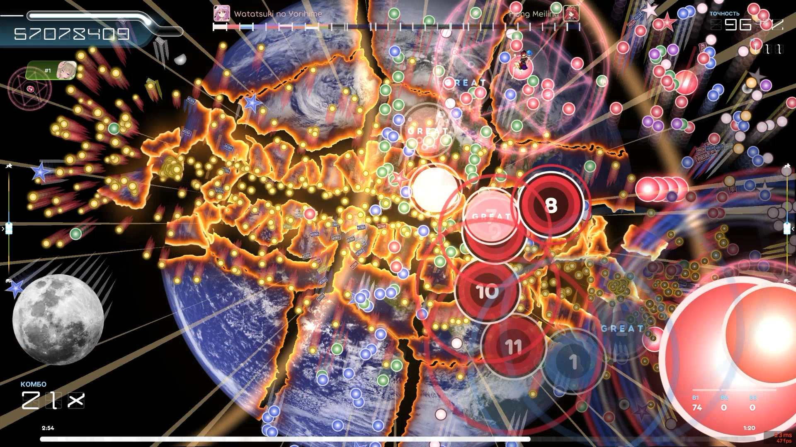
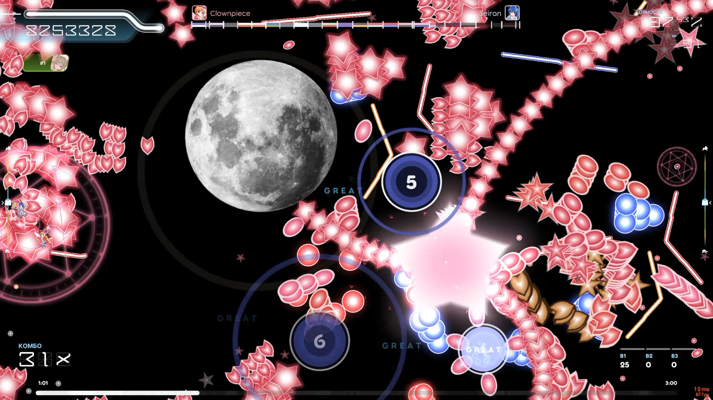
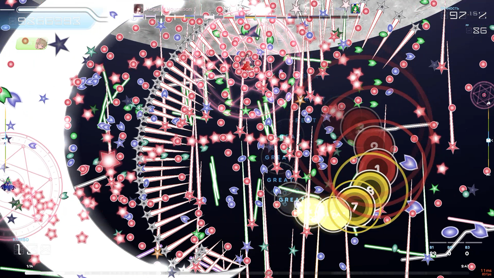
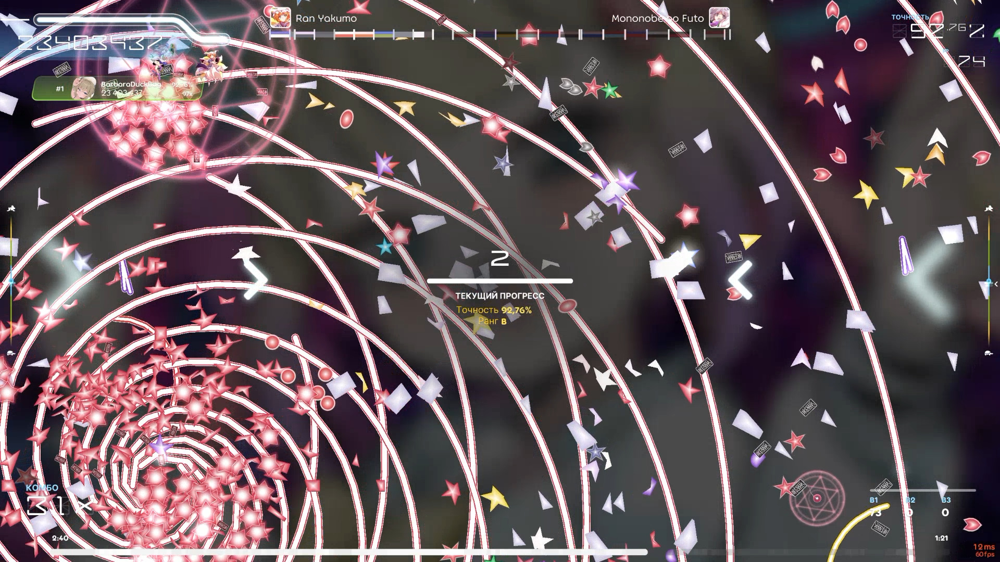
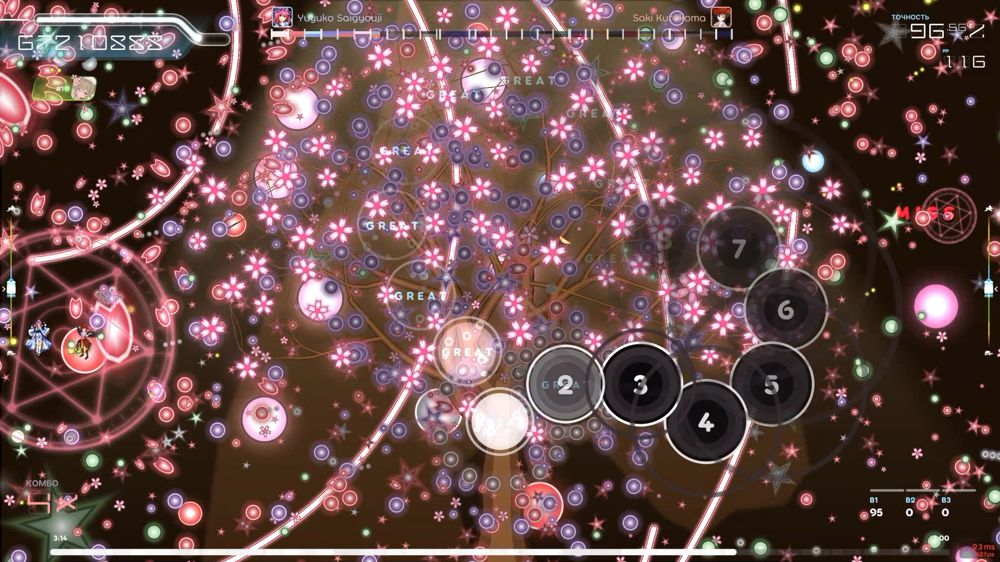
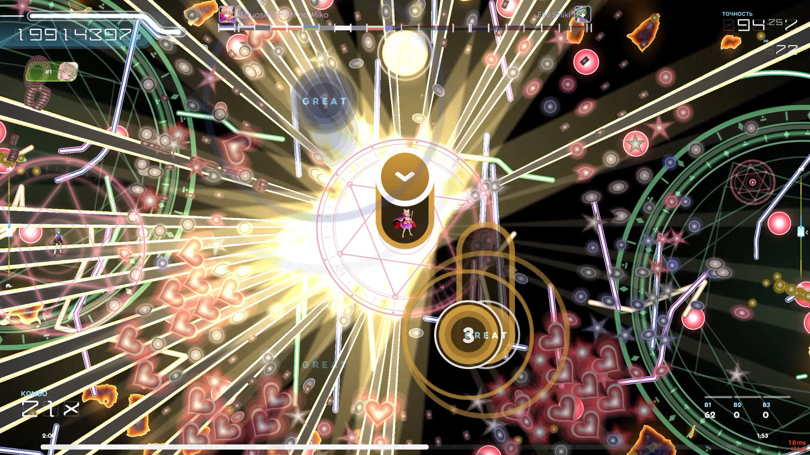
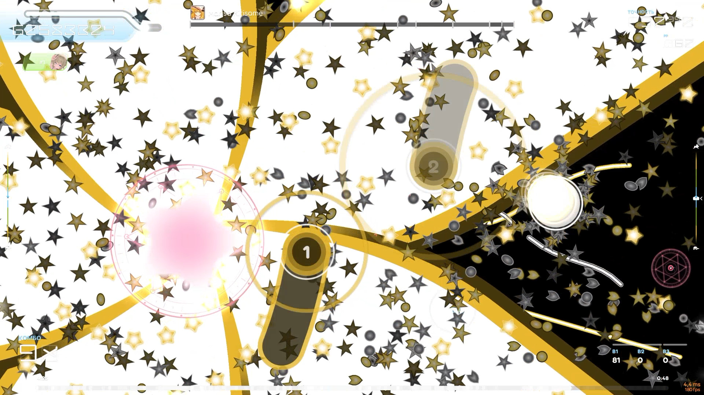
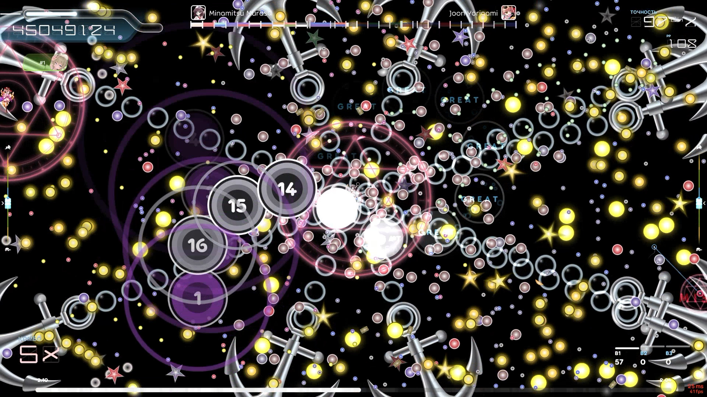
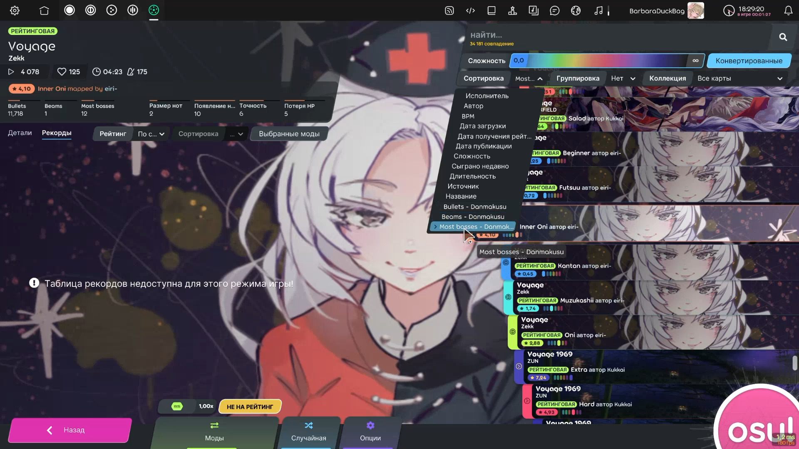

# Danmakusu

A fan-made ruleset for **osu!lazer**: osu!standard maps played as a bullet hell. The circles, sliders and spinners play themselves and fire bullets and laser beams to the music. Your job is to dodge.

Bosses take over the map's breaks, kiai sections and spinners. They are Touhou Project characters, each with a mechanic of their own. **77 of 144 characters** have theirs so far, and more are added all the time. The rest wait in the roster as placeholders with a shared attack.



## Features

- Every osu!standard map works. Maps of osu!mania, osu!taiko and osu!catch are converted too.
- One, two or three bosses at once (the Boss Selection, Double and Triple Boss Selection mods). Pick them yourself in the boss menu before a map, or let the map's colours choose.
- Song select shows Danmakusu's own star rating, how many bullets and beams a map has, and the most bosses it has room for. It can sort by any of these.

## Controls

Choose how you move in the boss menu before a map:

**Cursor only** (default): the character is wherever your cursor is.
- Hold **key 1 or key 2** to freeze the character in place while the cursor moves on. These are osu!standard's keys: Z / X or the mouse buttons by default, and 1 / 2 as well.
- While holding one key, press the **other** to move the frozen character to where the cursor is now.
- Let go of both keys and the character jumps to the cursor.

**Keyboard**:
- **W A S D** or the **arrow keys** move the character. Hold **Shift** to move at half speed. The speed can be set in the boss menu.
- **Space** puts the character on the cursor, and it stays on the cursor while Space is held.

The character gets hit by bullets, laser beams, a slider while it is moving, and a circle at the moment it is hit if you stand inside it. Every hit costs health and counts as a miss, and health slowly comes back over time. Your accuracy is how many objects you got through without being hit.

## Install

1. Download `osu.Game.Rulesets.Danmakusu.dll` from the [latest release](../../releases/latest).
2. In osu!lazer, open Settings → General → "Open osu! folder", and put the dll in its `rulesets` folder (on Windows: `%APPDATA%\osu\rulesets`).
3. Restart osu!lazer. Danmakusu appears next to the other modes.

The dll is built for osu!lazer **2026.916.0**. Another version may refuse to load it, or crash with it.

## Screenshots

| | |
|---|---|
|  |  |
| Clownpiece and Seiran | Kaguya Houraisan and Mima |
|  |  |
| Ran Yakumo and Mononobe no Futo | Yuyuko Saigyouji and Saki Kurokoma |
|  |  |
| Toyosatomimi no Miko and Eiki Shiki | Marisa Kirisame |
|  |  |
| Minamitsu Murasa and Joon Yorigami | Song select: bullets, beams, most bosses, and the Danmakusu sorts |

## Build

You need the [.NET 10 SDK](https://dotnet.microsoft.com/download).

```
dotnet build
```

The dll ends up in `bin\Debug\net10.0`. If osu!lazer is installed, the build also copies it into osu!'s `rulesets` folder, and **closes osu! first** (osu! keeps the old dll locked while it runs). To leave osu! running, build with:

```
dotnet build -p:CloseOsu=false
```

To build for another osu!lazer version, change the version of `ppy.osu.Game` and `ppy.osu.Game.Rulesets.Osu` in `osu.Game.Rulesets.Danmakusu.csproj` to that version (Settings → About shows it).

## Disclaimer

This is a non-commercial fan work. It is not affiliated with or endorsed by ppy (osu!) or Team Shanghai Alice (Touhou Project).

- The Touhou Project characters belong to ZUN / Team Shanghai Alice.
- The character art, sounds and other assets in `Resources` belong to their original creators.
- osu! belongs to ppy.
- The code was written by Claude Opus 5.5 (Anthropic) from the author's prompts.

No license is given, and the author claims no ownership of this work. If you own something used here and want it credited or removed, please open an issue.
